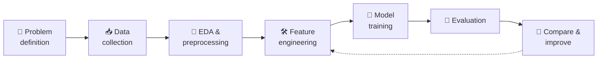
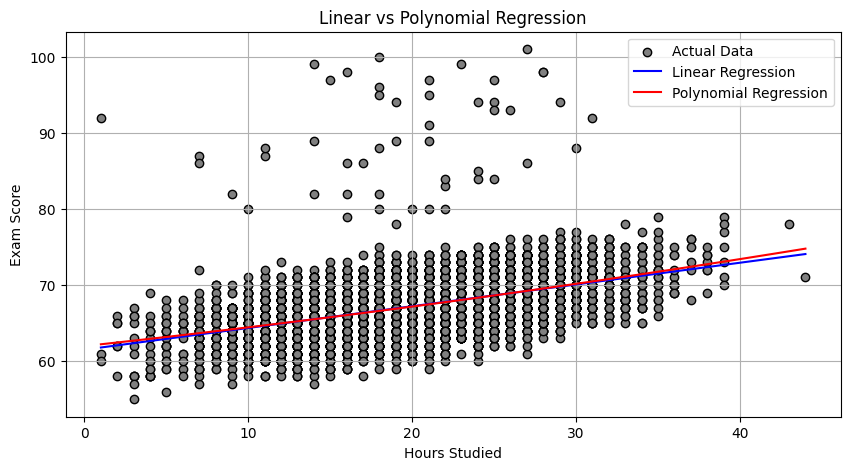
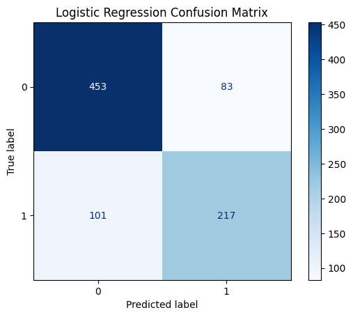
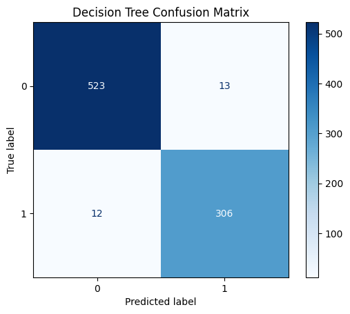
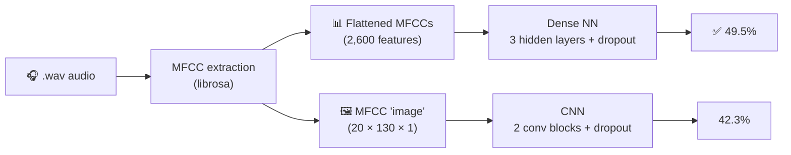
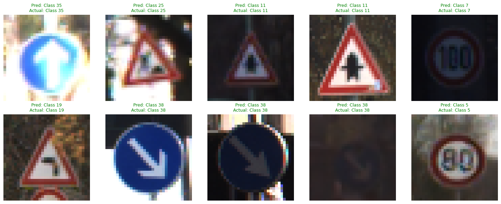
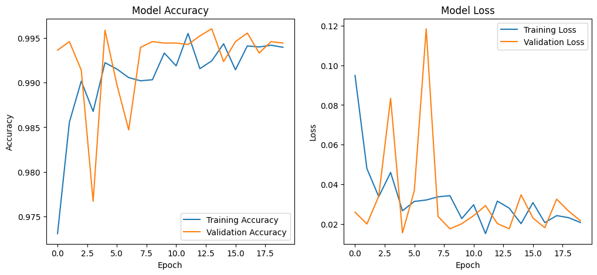

<div align="center">

# 🧠 Machine Learning Internship — Elevvo Pathways

**Four end-to-end machine-learning projects: regression, imbalanced classification, audio classification and computer vision.**


📅 **Jul – Aug 2025** · 🏢 **Elevvo Pathways** · 💼 **Machine Learning Intern**

</div>

---

## 📊 Results at a glance

| # | Project | Type | Data | Best model | Result |
|---|---|---|---|---|---|
| 1 | 📚 [Student Score Prediction](01-student-score-prediction) | Regression | 6,607 students | Linear vs. polynomial regression | R² = 0.23 from study hours alone |
| 2 | 🏦 [Loan Approval Prediction](02-loan-approval-prediction) | Binary classification (imbalanced) | 4,269 applications | Decision Tree + SMOTE | **97.1% accuracy · F1 0.96** |
| 3 | 🎵 [Music Genre Classification](03-music-genre-classification) | 10-class audio classification | GTZAN, 1,000 tracks | Dense NN on MFCCs | 49.5% accuracy (chance: 10%) |
| 4 | 🚦 [Traffic Sign Recognition](04-traffic-sign-classification) | 43-class image classification | GTSRB | MobileNetV2 (transfer learning) | **97.6% test accuracy** |

## 🔁 Workflow used in every project



---

## 1️⃣ Student Score Prediction 📚

> **Question:** how much of a student's exam score can study time alone explain?

- **Data:** Kaggle *Student Performance Factors*: study hours, attendance, sleep, previous scores, tutoring, family and school factors.
- **Approach:** cleaned columns with missing values, then fitted **Linear Regression** and compared it with **Polynomial Regression (degree 2)** on `Hours_Studied → Exam_Score`.

| Model | MSE | R² |
|---|---|---|
| Linear Regression | 10.86 | 0.232 |
| Polynomial Regression (deg 2) | 10.84 | 0.233 |

<div align="center">

</div>

**Takeaway:** the relationship is essentially linear, since the polynomial model adds nothing. Study hours explain about 23% of the variance, so the remaining factors (attendance, previous scores, …) are needed for a strong model.

---

## 2️⃣ Loan Approval Prediction 🏦

> **Question:** will a loan application be approved?

- **Data:** 4,269 applications with income, loan amount and term, **CIBIL credit score**, asset values, education and employment type.
- **Approach:** label-encoded categorical features, balanced the training set with **SMOTE**, and compared **Logistic Regression** with a **Decision Tree**.

| Metric | Logistic Regression | Decision Tree |
|---|---|---|
| Accuracy | 78.5% | **97.1%** |
| Precision | 72.3% | **95.9%** |
| Recall | 68.2% | **96.2%** |
| F1 score | 0.702 | **0.961** |

<div align="center">

| Logistic Regression | Decision Tree |
|---|---|
|  |  |

</div>

**Takeaway:** the decision tree cut misclassifications from **184 to 25** out of 854 test applications. Approval depends on sharp thresholds (especially the credit score) that a tree captures and a linear model cannot.

---

## 3️⃣ Music Genre Classification 🎵

> **Question:** can a model recognise a song's genre from its audio?

- **Data:** GTZAN, 1,000 thirty-second clips across 10 genres (blues, classical, country, disco, hip-hop, jazz, metal, pop, reggae, rock).
- **Approach:** extracted **MFCCs** with `librosa`, then compared two ways of representing them:



| Model | Input | Test accuracy | Test loss |
|---|---|---|---|
| Dense neural network | Tabular MFCCs | **49.5%** | 1.43 |
| CNN | MFCCs as an image | 42.3% | 1.69 |

**Takeaway:** both models are about 4–5× better than random guessing (10%). On a dataset this small, the simpler dense model generalised better than the CNN. Next steps would be mel-spectrograms, data augmentation and transfer learning from audio-pretrained models.

---

## 4️⃣ Traffic Sign Recognition 🚦

> **Question:** can a model reliably recognise 43 types of traffic signs, the kind of perception an autonomous vehicle needs?

- **Data:** GTSRB (German Traffic Sign Recognition Benchmark), 43 classes, downloaded through the Kaggle API.
- **Preprocessing (OpenCV):** read → BGR to RGB → resize → normalize to [0, 1], plus data augmentation.
- **Approach:** a **custom CNN** compared with **MobileNetV2 transfer learning**.

| Model | Test accuracy |
|---|---|
| Custom CNN (with augmentation) | 93.7% |
| **MobileNetV2 (transfer learning)** | **97.6%** |

<div align="center">

<br><sub>Sample test predictions: all correct, including dark and blurred signs.</sub>
<br><br>

<br><sub>Training and validation accuracy / loss.</sub>
</div>

**Takeaway:** transfer learning from ImageNet gave a +3.9-point gain over a CNN trained from scratch, which matters for safety-critical perception.

---

## 📁 Repository structure

```
ML-Intern/
├── 01-student-score-prediction/
│   └── student_score_prediction.ipynb
├── 02-loan-approval-prediction/
│   └── loan_approval_prediction.ipynb
├── 03-music-genre-classification/
│   └── music_genre_classification.ipynb
├── 04-traffic-sign-classification/
│   └── traffic_sign_classification.ipynb
├── assets/                     # Figures used in this README
└── README.md
```

## 🚀 Running the notebooks

Each notebook is self-contained and was developed in **Google Colab** (GPU runtime for tasks 3 and 4).

1. Open a notebook in Colab: **File → Open notebook → GitHub** and paste this repository's URL.
2. Get the data:
   - **Tasks 1–3:** download the Kaggle dataset ([Student Performance Factors](https://www.kaggle.com/datasets/lainguyn123/student-performance-factors), [Loan Approval](https://www.kaggle.com/datasets/architsharma01/loan-approval-prediction-dataset), [GTZAN](https://www.kaggle.com/datasets/andradaolteanu/gtzan-dataset-music-genre-classification)) to Google Drive and update the path in the loading cell.
   - **Task 4:** the notebook downloads GTSRB itself through the Kaggle API; upload your `kaggle.json` token when prompted.
3. Run all cells.

## 🛠️ Skills demonstrated

`Regression` · `Classification` · `Class imbalance (SMOTE)` · `Feature engineering` · `Audio feature extraction (MFCC)` · `CNNs` · `Transfer learning` · `Data augmentation` · `Image preprocessing (OpenCV)` · `Model evaluation & comparison`

---

<div align="center">
<sub>Made by <a href="https://github.com/zeyad4231">Zeyad Rashwan</a> during the Elevvo Pathways Machine Learning Internship.</sub>
</div>
